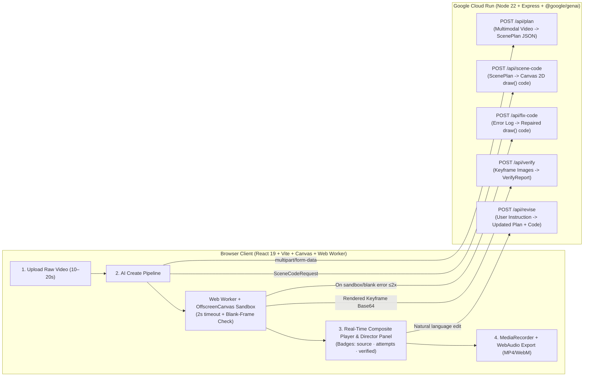

# YouTube AI Studio — Just Record. AI Does the Rest.

> **Google DeepMind AI Hackathon (Build with Gemini) — AI Studio for Creators**
>
> *Unofficial hackathon prototype inspired by YouTube Studio, powered by **Gemini 4 Argon** (`ARGON_MODEL=gemini-4-argon`) and deployed on **Google Cloud Run**.*

---

## 🌐 Live Demo & Repository

- **Cloud Run Live URL:** [`https://youtube-ai-studio-877956401307.asia-northeast3.run.app`](https://youtube-ai-studio-877956401307.asia-northeast3.run.app)
- **Health Check Endpoint:** [`https://youtube-ai-studio-877956401307.asia-northeast3.run.app/api/health`](https://youtube-ai-studio-877956401307.asia-northeast3.run.app/api/health)
- **GitHub Repository:** [`https://github.com/AIjunja/youtube-ai-studio`](https://github.com/AIjunja/youtube-ai-studio)

---

## ✨ Problem & Solution

Solo creators spend hours cutting out claps, retakes, and awkward silences, and even more time building motion graphics in After Effects or Remotion to explain complex concepts they only mentioned verbally.

**YouTube AI Studio** embeds an autonomous **Argon Director** directly inside a familiar YouTube Studio workflow (**1. Upload → 2. AI Create → 3. Verify → 4. Download**):

1. **Multimodal Video Planning (`POST /api/plan`)**
   - Watches and listens to a 10–20s raw creator clip via `@google/genai`.
   - Extracts timestamped transcripts, detects NG/retake/silence cuts with confidence scores (`confidence < 0.7` is surfaced as a user-confirmable suggestion rather than auto-deleted), and identifies **Explanation Gaps (`gaps`)** where viewers need visual context.
   - Outputs a strict Zod-validated `ScenePlan` JSON (`keep`, `cuts`, `gaps`, `scenes`, `uncertainFacts`).
2. **Deterministic Motion Graphic Code Generation (`POST /api/scene-code`)**
   - For every missing explanation (`motion` and `ending` scenes), **Gemini 4 Argon** writes a pure, deterministic HTML5 Canvas 2D function body `draw(ctx, t, w, h, scene)` (>=48px typography at 1080p, `#F8F9FA` paper background, `#111111` ink text, `#C6FF00` lime accent).
3. **Isolated Worker Sandbox & Self-Repair Loop (`POST /api/fix-code`)**
   - Generated code is statically scanned for forbidden tokens (`fetch`, `XMLHttpRequest`, `WebSocket`, `importScripts`, `eval`, DOM globals) and executed inside an isolated **Web Worker + `OffscreenCanvas`** sandbox with a 2,000ms per-frame timeout.
   - Renders test frames at `t = 0.5s` and `t = duration * 0.5s` to check for runtime exceptions or blank frames.
   - If validation fails, the error trace is sent back to `/api/fix-code` (up to 2 automatic repair attempts) before falling back to 6 deterministic Canvas templates (`template-fallback`) so video export never breaks.
4. **Multimodal Visual Verification & Natural-Language Revision (`POST /api/verify`, `POST /api/revise`)**
   - Rendered keyframe PNG/JPEGs are sent back to Argon multimodally (`/api/verify`) to inspect legibility, layout overlap, and alignment with the script.
   - Creators can revise any scene in natural language (e.g., *"make this simpler"* or *"글자를 더 크게 하고 핵심 키워드를 라임색으로 강조해줘"*) via `/api/revise`, which updates both the `ScenePlan` and the live Canvas `draw()` code.

---

## 🏗️ Architecture



---

## 🛡️ Safety & Engineering Principles

- **Code Sandbox Isolation:** Model-generated Canvas code runs inside an isolated Web Worker with `fetch`, `XMLHttpRequest`, `WebSocket`, and `importScripts` stripped, plus a strict 2-second per-frame timeout.
- **Fact Integrity (`uncertainFacts`):** Uncertain statistics or claims are never hallucinated into motion cards; they are isolated into `uncertainFacts` and highlighted in the Director Panel for creator review.
- **Conservative Cut Editing:** Cuts with `confidence < 0.7` are never auto-deleted; they appear as optional toggles (`제안 · 사용자 확인`).
- **Guaranteed Output:** Even if model code fails after 2 self-repair attempts, deterministic Canvas templates (`title`, `bullets`, `diagram`, `compare`, `kinetic`, `ending`) guarantee a complete playable video export.

---

## 🚀 Local Setup & Execution

### Prerequisites
- Node.js 22+
- A Gemini API Key (`GEMINI_API_KEY`)

### 1. Install Dependencies
```bash
npm install
```

### 2. Configure Environment Variables
Copy `.env.example` to `.env` and fill in your values (never commit `.env`):
```bash
cp .env.example .env
```
```dotenv
GEMINI_API_KEY=your_gemini_api_key_here
ARGON_MODEL=gemini-4-argon
PORT=8080
```

### 3. Run in Development Mode
```bash
npm run dev
```
- Frontend + API server (via Vite proxy): `http://localhost:5173`
- Backend Express server: `http://localhost:8080/api/health`

### 4. Production Build & Start
```bash
npm run typecheck
npm run build
npm start
```

---

## ☁️ Deploy to Google Cloud Run

```bash
gcloud run deploy youtube-ai-studio \
  --source . \
  --region asia-northeast3 \
  --allow-unauthenticated \
  --memory 1Gi --cpu 1 --timeout 180 \
  --set-env-vars="ARGON_MODEL=gemini-4-argon"
```
*(Set `GEMINI_API_KEY` securely via Cloud Run environment variables or Secret Manager — never commit keys to git.)*
